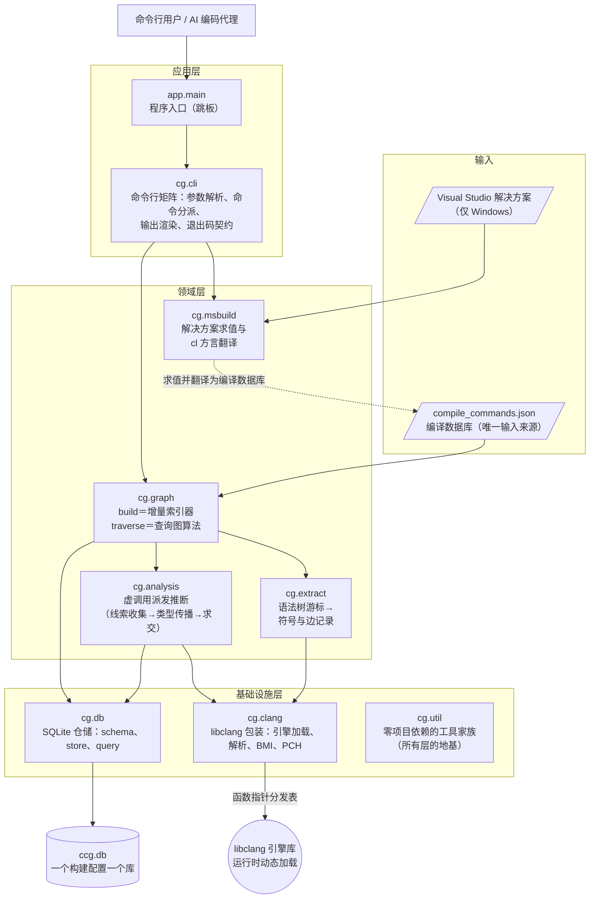

# ccg —— C++ 代码知识图谱引擎与命令行工具链

ccg（cpp-code-graph）把一个 C++ 代码库完整解析成一张语义图：符号是节点，调用、继承、虚函数覆写、类型使用是边。整张图存进单个 SQLite 文件，之后在命令行上回答那些靠文本搜索答不准、靠人工翻代码答不全的问题——"谁调用了这个函数""改这一行会波及谁""这个接口有几个实现""头文件包含关系里有没有环"。

解析引擎是 libclang（编译器级的语义解析，不是文本模式匹配），存储是 SQLite（一个构建配置一个库文件），ccg 自身则是一个百分之百 C++23 具名模块（`import std;`）写成的工具链。

> **三个亮点**
>
> - **编译器语义，不是文本猜测**——每条边都带着解析置信度落库；解析不了的边宁可丢弃并如实报数，也绝不连一条可能错误的边。
> - **从 .sln 到代码图一条命令**——进程内求值 Visual Studio 解决方案，不跑构建、不改工程文件，典型解决方案秒级出库。
> - **编辑后秒级增量，无守护进程、无锁文件**——SQLite 库本身就是队列与协调器，持有者崩溃后租约自动过期、被下一次调用接管，代码图随每一次保存保持常新。

---

## 它解决什么问题

大型 C++ 工程里，下面这几类问题出现的频率极高，但现有手段很难答准、答全：

- **"谁调用了这个函数？"**——文本搜索答不出语义：同名重载、命名空间限定、通过基类指针发生的虚调用，grep 全都分不清。IDE 的调用层级通常停在单翻译单元（单个 .cpp 源文件连同它包含进来的全部内容，编译器一次编译的基本单位）视野或接口方法的静态目标上，多态调用落到哪个具体实现，答案要么缺失、要么一股脑全列出来且不区分"已证明"与"猜测"。
- **"改这一行会影响谁？"**——影响是沿着调用链、继承链、类型使用链**传递**扩散的。改一个被 300 处调用的公共函数、改一个被广泛继承的基类方法，波及面需要沿图做闭包计算，这不是人眼能数清的，也不是任何单文件视角的工具能回答的。
- **"这个接口/虚函数有几个实现？"**——沿继承链找全部派生类与覆写版本，需要跨翻译单元的 overrides 关系，文本工具只能靠名字猜。
- **"我的头文件包含关系健康吗？"**——包含环、扇入最大的头文件，需要在 include 图上跑环检测与统计。

ccg 的答案分两步：先把整个代码库**全保真解析**成语义图（符号＋边），以节省存储的方式存进一个 SQLite 文件；再提供一组查询、影响分析、路径追踪、图导出命令，直接在图上回答上面所有问题。

一条贯穿全部设计的原则：**一张错误的图比缺失的图更危险**。所以 ccg 绝不扫描目录瞎猜要索引的内容（没有编译数据库，即记录每个源文件完整编译命令的 compile_commands.json，就报错退出），绝不静默回退到另一个解析引擎，绝不把不确定的推断伪装成唯一答案，解析失败的翻译单元逐个记名分诊而不是静默跳过。

## 核心能力总览

命令行矩阵分四类：索引与维护、符号与关系查询、变更与影响分析、导出与概览。

### 索引与维护

| 命令 | 功能 |
| --- | --- |
| `ccg index` | 给 C++ 项目建代码图数据库：读编译数据库，用 libclang 逐个翻译单元解析，把符号和调用/继承等关系存进一个 SQLite 文件；重复运行时自动增量，只重解析真正变了的文件 |
| `ccg update` | 把你改过的文件喂给增量引擎做一次性刷新，为编辑器钩子设计；没有常驻后台进程、没有锁文件 |
| `ccg msbuild` | 一条命令把 Visual Studio 的 .sln 解决方案变成已索引的数据库（仅限 Windows），默认不跑构建、秒级求值出编译命令 |
| `ccg config` | 按数据库查看和设置配置：换哪个 LLVM 引擎解析、并行度、刷新协调超时、追加编译选项 |
| `ccg hook` | 往 Claude Code 的 settings.json 里安装/卸载四个钩子，让数据库随每次编辑自动刷新、让搜索自动带上代码图事实 |

### 符号与关系查询

| 命令 | 功能 |
| --- | --- |
| `ccg query` | 按名字找符号，三层匹配（精确、限定名后缀、子串）外加拼错时的模糊建议；`--implements` 反向列出某接口的全部派生类 |
| `ccg context` | 一个符号的 360 度视图：定义在哪、谁调用它、它调用谁、继承谁、被谁使用，虚函数自动合并覆写家族 |
| `ccg members` | 列出一个 struct/class 的全部成员（自有＋沿继承链），不用重读头文件 |
| `ccg callers` | 谁调用这个函数，可逐层展开到第 10 层；零调用者时明确提示死代码候选 |
| `ccg callees` | 这个函数调用谁，同样可逐层展开 |

### 变更与影响分析

| 命令 | 功能 |
| --- | --- |
| `ccg impact` | 波及面分析：改这个符号会牵连谁，按深度分桶并给风险分数和档位（低/中/高/危） |
| `ccg trace` | 两个符号之间的最短调用路径，逐跳打印 |
| `ccg changes` | 把变更文件列表映射到图上，列出所有受影响的下游消费者；可直接接 `git diff --name-only` 管道 |
| `ccg check --cycles` | 头文件包含环检测，发现环时退出码 3，可直接当 CI 门禁 |

### 导出与概览

| 命令 | 功能 |
| --- | --- |
| `ccg graph` | 把调用图导出成 Graphviz dot（给人看）或 JSON（给程序用），可从单个符号展开或按模块聚合 |
| `ccg stats` | 数据库摘要：多少文件、多少符号、多少边、库多大 |

所有命令支持 `--json` 机器可读输出（错误也走 JSON 的 `error`/`partial` 字段）；退出码契约全家族统一（见[诚实契约与退出码](#诚实契约与退出码)）。

## 独到优势

这一节讲 ccg 与业界常见做法拉开差距的地方。

### 1. 编译器语义级的跨翻译单元虚调用派发解析

经基类指针或引用调用虚函数时，实际会落到哪个具体实现？业界常见做法要么停在接口方法的静态目标（IDE 调用层级最典型），要么把全部可能的实现一股脑展开成"过近似"，既不区分"已证明"与"估计"，也不给置信分层。

ccg 在**整个代码库范围**收集"这个指针实际指向什么类型"的证据——`new T`、`make_unique` 的返回值流动、转型、取地址、实参传递、跨函数的返回值流——用静态类型推断把调用点解析到具体实现：

- 解析成功的目标带**置信度**落库：1.0 高（`new Impl` 之类直接证据）、0.7 中（单类型传播）；默认证据阈值 0.7，达标目标**直接替换**覆写家族的过近似。
- 解析不了时如实标注这是整个覆写家族的估计（family estimate），绝不虚报置信数字，绝不从候选里挑一个装作唯一答案；多个可能目标时列出全部候选（上限 64 条，截断时显式标记 `candidates_truncated`）。
- 每个未解析的调用点在库里有机器可读的"为什么没解析"原因（`indirect_call`、`slot_type_truncated` 等完整词表），可 SQL 审计。
- `--no-dispatch` 一键回到纯静态上界（与该功能上线前的输出逐字节一致）；`--dispatch-fallback` 额外显示低于阈值证据的标记。

建立在编译器语义（而非文本类型推断）之上的跨翻译单元派发解析＋置信度阶梯＋如实降级，这个组合在同类工具中很少见。

### 2. 一条命令把 .sln 变成已索引的数据库

MSBuild 生态没有编译数据库导出的通行机制，业界常见替代要么真跑一遍构建来捕获命令（慢、有副作用、会覆盖产物），要么对工程文件做文本解析去猜命令（保真度无保证——猜错的编译命令就是猜错的图）。

ccg 的默认通道是**求值**：在自己进程内加载 Visual Studio 自带的 Microsoft.Build 引擎，做与 MSBuild 构建前完全同源的工程求值，读出每个翻译单元的最终编译配置（37 项元数据：宏定义、include 目录、语言标准、预编译头（PCH）、模块产物等），按 MSBuild 编译任务自己的开关顺序组装出编译命令，直接入库。**不跑构建、不把任何工具换成桩（只记录调用、不真执行的替身）、不改工程文件**，典型解决方案秒级完成（59 个工程、1655 个翻译单元约 4.5 秒）。

另备两条显式通道用于验证：`--record` 把编译类工具换成只记录参数、什么也不写的桩（零磁盘副作用，产出可与求值通道逐字节比对）；`--full-build` 真实编译（金标准交叉校验）。`--export-only` 产出的 compile_commands.json 也可以直接给其他支持该格式的工具使用。

细节上的诚实：求值逐工程解析真实 cl.exe（混合工具集的解决方案各项目用各自的编译器查询），INCLUDE 环境变量里的每个目录都展开成 `-imsvc` 参数并附 `/X`——产出的数据库自包含，不依赖任何 shell 环境；翻译层只做被证明必要的编辑并自动追加两条语义等价项；失败绝不静默——工程级失败逐行披露、缺 import 时降级求值并明示提示、通道级失败保留旧数据并以退出码 1 退出，**绝不自动换通道**。

### 3. C++20 具名模块全链路支持

使用 `import` 的代码库（.ixx/.cppm 接口单元、`import std;`）对索引工具是块硬骨头：消费者解析 `import` 时，必须先把对应的模块 BMI（二进制接口文件）喂给它，而多数工具遇到具名模块要么直接失败、要么整体跳过，甚至有工具把 `import X;` 误解析成变量声明而不报任何错。

ccg 有三层递进办法：

1. **直接重放**编译数据库里记录的模块编译命令，包括响应文件（把太长的编译参数写进一个文件、用 `@文件名` 引用）展开后、已经带着模块依赖参数（如 `-fmodule-file`）的条目；
2. 编译数据库里没有这些模块依赖参数时，**BMI 自构建**：用引擎自带的 clang-scan-deps 对每个单元做 P1689 依赖扫描（P1689＝向构建系统描述 C++ 模块依赖关系的标准格式），自己发现并构建 std 模块（按引擎配套的标准库：libc++/libstdc++/MSVC STL 三种来源），再按拓扑序把接口单元构建成精简 BMI（只含接口、不含实现体的瘦身形态）；缓存按（引擎、配置、工具集）分目录，编辑后只在受影响下游级联重建；
3. MSVC/cl 方言的工程同样能走（MSVC 工具集自带的 std 模块、cl 的开关拼写、`import std` 与文本包含混合的规则）。

实在构建不出来时按**具名失败类别**（`std-bmi-build-failed`、`module-build-failed`、`module-dag-cycle` 等）降级到普通解析，但 `import` 关系仍然落地入库——降级是响亮的，不是静默的。在只有编译数据库的输入上把 std 模块与接口依赖图自建出来的完整链路，是同类工具里的稀缺能力。

### 4. 一个构建配置一个数据库，一个数据库一个引擎

Debug 和 Release 的图约 90-100% 相同，但 `#ifdef` 分支不同——合并进一个库会导致公共符号歧义多重匹配、不同配置的相同调用点被悄悄合并、Release 的导入骑在过期的 Debug 选项上。ccg 的答案干脆利落：

- **多配置编译数据库自动拆分**：一份含多个内部配置的 compile_commands.json 自动按配置拆成多个数据库，互不污染，没有例外。
- **MSBuild 解决方案每对（配置, 平台）一个库**（如 Debug-x64 一个、Release-x64 一个），集中布局＋项目根一份微型注册表（`.ccg/msbuild.json`）跨配置发现入口，`--all` 一次建全部配置，可单独删除或压缩任何一个库。
- **解析引擎（libclang）不编进可执行文件**：ccg.exe 的导入表完全不碰 libclang，引擎库在运行时动态加载，**每个数据库绑定一个引擎**——一个库一个解析世界观。引擎身份（路径＋版本串）记录在库里；换了引擎、升级了工具链，下一次运行自动触发该库全量重索引并附通知，**绝不静默换引擎**。不同项目需要不同 LLVM 版本时互不干扰。
- 引擎解析顺序：数据库里的 `llvm-path` 配置 → 命令行 `--llvm-root` → 环境变量 `CCG_LLVM_ROOT` → PATH 上 clang 所在的工具链根。完全找不到是点名各旋钮的可操作错误，绝不静默落到别的引擎。

附带一个工程收益：因为引擎按库运行时加载，真实运行时依赖只剩一个约 1.55 MB 的动态库，发布物不需要携带体积上百 MB 的引擎全套文件。

### 5. 无守护进程、无锁文件的近实时刷新

同类工具保持索引常新，通常依赖常驻进程、文件监听守护或锁文件——各自都是故障源。ccg 的形态不同：**数据库本身就是协调者**。

- 待更新表当队列，单行认领表当排他锁（SQLite 事务取代一切锁原语）；每次刷新是一个短生命周期进程，活跃认领存在时后来者入队即退，持有者循环排空队列。
- **崩溃自愈**：认领带租约（默认 5 分钟）与内嵌进程号；持有者崩溃后租约到期、进程号探活判死，下一个进程自动抢占接管，不需要任何人删锁文件。解析阶段由伴生线程续租（实测 26 分钟的解析阶段也不掉租约），提交事务内每 60 秒一拍心跳；提交段发现租约被抢占则整批干净回滚，一行都不落库。
- **编辑与索引并发安全**：`ccg index` 默认以 `--wait` 排在活跃批次后接管（最多等 30 分钟），`--no-wait` 快速失败。
- 配套 `ccg hook install` 一条命令接入 Claude Code（详见[快速上手](#快速上手)）。
- 项目文件事件联动：编辑 .sln/.vcxproj/.props 不再被丢弃——防抖（默认 3 秒）→ 输入哈希比对（输入没变就零开销跳过）→ 重新采集 → 补一轮增量索引，失败保留旧数据待重试。

没有钩子的环境也能用：`git diff --name-only | ccg changes`，或逐文件 `ccg update` 加末尾 `--drain` 排空队列。

### 6. 增量等于重建，并行等于串行

索引工具的两个经典信任问题在 ccg 这里被测试钉死，而不是口头承诺：

- **增量等价性**：对任意编辑序列，增量运行的结果与推倒重建**逐表相等**（计时与元数据除外），由测试套件用归一化比较锁死。增量不会"越用越歪"。
- **并行确定性**：无论并行多少工作线程、哪个线程先完成，全部写入发生在调用线程、按编译数据库顺序，存储的行与串行全量运行完全一致。`--jobs` 只改速度，不改结果。
- 符号身份键（kind＋命名空间＋名字＋定义文件＋参数哈希）在跨重索引间保持稳定，sym_id 不漂移。
- 新鲜度判定分层省钱：先 stat（修改时间＋大小）快速路径，有变化再 sha256 内容确认，再逐条目比对编译命令摘要——切分支改了 mtime 但内容没变时，几秒确认代替几分钟重解析。

对把 ccg 的事实喂给自动化流程（CI 门禁、AI 代理注入）的场景，这个确定性是前提而不是加分项。

## 架构一览



图的读法与几条承重设计：

- **依赖方向严格单向，且机器强制**：util 零项目依赖垫底；db 与 clang 互不相识（存储层完全不知道解析器的存在）；extract 只建在 clang/util 上；graph 消费 extract/analysis/db；cli 扇入一切；app.main 只是进 cli 的跳板。分层边界不是口头约定——单向本身由模块 BMI 依赖图在构建期强制（import 成环就无拓扑序，构建无法完成）；在此之上，analysis 的依赖边界与构建输入不含机器绝对路径两项纪律，另由扫描脚本逐行检查全部模块单元，ctest 测试门禁钉死，越界即测试失败。
- **一条数据流**：编译数据库（可能由 msbuild 域从 .sln 求值翻译产出）进入 graph.build 增量索引器 → 新鲜度扫描、脏集沿 include 图扩散 → 工作线程池并行调用 extract/analysis 经 clang 包装层解析 → 单一批次事务落库。查询命令走 graph.traverse，纯只读；唯一写入方是索引器。
- **引擎运行时加载**：ccg 对 libclang 永远不做链接期依赖；加载后所有库调用走一张按名填充的函数指针分发表，项目里零直接 C API 调用；解析会话存续期间拒绝切换引擎。
- **百分之百 C++23 具名模块**：包括入口 main 在内每个源文件都是模块单元（仅五个经典翻译单元例外，每个都有编译器层面的硬理由记录在注释里）；单个接口文件约 300 行就拆子模块，保持严格分层无环的模块依赖图。
- **存储访问受控**：查询与写入全部经类型安全查询库（sqlpp23 预编译语句）访问；建表 DDL 与连接 PRAGMA 经连接原语逐字执行；JSON 只有一个被允许的第三方依赖，且只能经门面模块访问；字符串驻留（每个重复字符串只在字典表存一份，全库用整数 id 引用）让热查询变成整数索引连接，比不做驻留约省四成字节。
- **跨平台纪律**：每个操作系统关注点恰好归一个平台封装单元、且两个分支都必须实现（操作系统接口、崩溃防护、动态库加载、CLR 宿主各归一处，工程其他任何地方不得直接包含平台头）。
- **可复现构建**：第三方依赖全部经包管理器钉死到具体提交号或标签，留有镜像前缀覆盖变量；系统级依赖自适应发现、绝不硬编码机器绝对路径（配套扫描脚本逐行检查，ctest 测试门禁钉死）。
- **自举自证**：ccg 自己就是全模块 C++23 工程，`ccg graph` 导出的调用图直接供给自己的 Doxygen 文档站——Doxygen 原生看不懂 `import` 进来的跨模块调用，ccg 的 calls 边是那里唯一权威的数据源。

## 快速上手

### 第一步：构建与安装

ccg 从源码构建交付（自身支持 clang 与 MSVC 双工具链，均使用 Ninja Multi-Config 生成器；MSVC 路线要求 CMake ≥ 4.4，且需在 x64 Native Tools Command Prompt 里配置）：

```bash
cmake --preset clang-dev            # 或 msvc-dev
cmake --build build/clang-dev --config Release
cmake --install build/clang-dev --config Release --prefix <发布目录>
```

产物是一个**扁平发布目录**：`ccg`（或 `ccg.exe`）二进制、`.ccg/`（编辑器钩子材料）、`docs/`（全部手册随包分发）、`ccg-install.cmd` 与 `ccg-install.sh`（PATH 安装器）。三者必须保持同级——钩子安装与文档解析都依赖这个相对位置。

在发布目录下运行对应 shell 的安装器入 PATH：

- `ccg-install.cmd`——cmd / PowerShell 用（写用户级注册表，避开 setx 的 1024 字符截断问题）；
- `ccg-install.sh`——bash 用（含 Git Bash）。

安装幂等（重复运行只刷新垫片）、垫片按绝对路径转发（往同目录放新二进制即生效，无需重装）、仅对新开的终端生效——装完**另开终端**跑 `ccg --version` 验证。不想用垫片的替代：设 `CCG_BIN` 为二进制完整路径，或直接把发布目录加进 PATH。

前提：机器上要有一个带 libclang 的 LLVM 发行版（引擎运行时加载，发现顺序见[独到优势第 4 条](#4-一个构建配置一个数据库一个数据库一个引擎)；也可用 `CCG_LLVM_ROOT` 环境变量显式指定）。

### 第二步：索引第一个工程

前提是 compile_commands.json（CMake 工程加 `-DCMAKE_EXPORT_COMPILE_COMMANDS=ON` 导出；Visual Studio 解决方案改走 `ccg msbuild`）。在项目根目录：

```bash
ccg index . --config main
```

`--config` 是 index 的必填参数（命名配置目录，数据库与其派生产物都住里面）；`--compile-commands` 省略时自动在每个根下搜索 compile_commands.json（根本身 → root/build → 一层子目录）。数据库默认落在 `$CCG_DB`（若设置）否则 `./.ccg` 下的 `<文件夹>/<配置名>/ccg.db`。

索引结束打印摘要（fresh/stale/skipped/failed 的翻译单元计数、符号与边统计、耗时与库大小）。首次成功运行记录 profile（根、编译数据库路径、引擎身份、生效参数），此后**裸命令 `ccg index --config main` 重跑即从 profile 恢复全部输入**，且对已存在的数据库默认增量。

### 第三步：跑三个最有用的查询

```bash
ccg query draw                        # 找符号：三层匹配，拼错给模糊建议
ccg context shape::Circle             # 360 度视图：定义、进出边、使用点坐标
ccg impact shape::Circle::area --direction up --depth 3
                                      # 波及面：按深度分桶＋风险分与档位
```

实用细节：查询侧命令在文件夹里恰好只有一个配置时可省略 `--config`（唯一配置自动选中）；符号名支持非限定名（`Circle`）、限定名（`shape::Circle`）、限定链（`Canvas::draw`）与子串；歧义时列出候选（类别＋限定名＋file:line）并以退出码 1 退出，`--file`/`--kind` 消歧；`--exclude-glob` 通配路径过滤（`build/**`、`_deps/*`），只影响结果不影响库。

### 第四步（可选）：让数据库随编辑自动刷新

```bash
ccg hook install --project    # 目标 ./.claude/settings.json，从仓库根跑
```

一条命令注册四个 Claude Code 钩子：PostToolUse（每次编辑后毫秒级入队刷新，批次运行中走快速路径绝不阻塞编辑器）、SessionStart（报数据库状态＋清扫残留）、UserPromptSubmit（把批次期间积累的编辑结论以一条封顶 1200 字节的影响面摘要注入）、PreToolUse（搜索前注入符号图事实：唯一命中给五行有界答案——身份/定义坐标/同名消歧/top3 调用者/派发置信度；多命中给候选列表；Grep、Bash(rg)、PowerShell(Select-String)、Search 四条支路统一门控）。

钩子在宿主 10 秒硬上限内工作（绝对截止 9 秒，其余 POSIX 平台 8 秒），到点**分离而不杀死**后台刷新子进程，注入内容改为说明基于既有索引。升级既有安装：重跑 `ccg hook install`（自有条目按命令识别并被改写为当前规格）然后重启 Claude Code 会话——两步都必需。卸载默认试运行（`--force` 才执行），恰好移除 ccg 自己的条目、邻居不动。

### 命令速查表

```bash
# 索引与维护
ccg index . --config main            # 首次索引（--config 必填）
ccg index --config main              # 裸重跑：从 profile 恢复，默认增量
ccg index --config main --dry-run    # 毫秒级打印计划（几个翻译单元（TU）待重解析、多少字节），不碰引擎
ccg index --config main --full       # 强制全量重索引
ccg update src/render/canvas.hpp     # 把改过的文件喂给增量引擎
ccg update --drain                   # 会话收尾：把队列处理到空
ccg msbuild DemoSln.sln              # .sln → 已索引数据库（仅 Windows；--all 建全部配置）
ccg config get                       # 看配置（含记录引擎与当前解析引擎的差异警告）
ccg config set index-jobs 8          # 设并行度（1-64，默认 auto=min(核数-2, 12)）
ccg hook install --project           # 装 Claude Code 四钩子

# 符号与关系查询
ccg query draw                       # 找符号（--implements：列出某接口全部派生类）
ccg context shape::Circle            # 360 度视图（虚函数自动合并覆写家族）
ccg members shape::Circle            # 全部成员（自有在前、继承按链分组）
ccg callers shape::Circle::area --depth 2
ccg callees app::render_frame

# 变更与影响分析
ccg impact shape::Circle::area --direction up --depth 3 --top 2
ccg trace app::main shape::pi        # 两符号间最短调用路径
ccg changes src/shapes/circle.hpp src/gone.cpp
git diff --name-only | ccg changes   # 管线形态（stdin 自动读列表）
ccg check --cycles                   # 包含环检测（退出码 3=发现环，可当 CI 门禁）

# 导出与概览
ccg graph --symbol render::Canvas::draw --depth 2 --format dot
ccg graph --modules                  # 模块级聚合图
ccg stats                            # 文件/符号/边/库大小摘要

# 通用参数
--json                               # 任何会打印结果的命令都接受
--kind function --file render        # 类别与文件消歧
--exclude-glob "build/**"            # 通配路径过滤（* ? **，大小写不敏感）
--no-dispatch / --dispatch-fallback  # 派发三档开关
```

## 输入形态与平台矩阵

### 三种输入通道

| 通道 | 说明 |
| --- | --- |
| compile_commands.json（主通道） | clang/gcc 方言条目原样重放；cl 方言（MSVC 拼写）条目经方言对齐与内存中修正进入索引 |
| Visual Studio 解决方案（Windows） | `ccg msbuild <path.sln>` 一条命令从 .sln 到已索引数据库；默认求值通道（不跑构建、典型秒级），`--record` 捕获通道（测试验证设施），`--full-build` 真实编译金标准；每对（配置, 平台）一个数据库 |
| 项目根目录 | 把根目录传给 `ccg index`，自动在根下搜索编译数据库（根本身 → root/build → 一层子目录） |

**硬前提**：编译数据库是唯一输入来源，没有它 `ccg index` 以退出码 2 失败并列出三条可行的解决办法（CMake 导出 / 用 ccg msbuild / 显式传 `--compile-commands`）。ccg 绝不靠猜——一张错误的图比缺失的图更危险。"裸目录无编译数据库也能索引"不成立，也不应成立。

MSVC 方言的翻译层有完整的失败类别分诊：逐 TU 记录失败类别（`module-bmi-missing`、`msvc-permissive-*` 等十余种），摘要汇总，文档附失败类别 → 补救措施对照表（如注入 `-Wno-non-pod-varargs`、`-fdelayed-template-parsing`、MSVC 宽松模式特有的模板写法由编译器 fixit 在内存中自动改写）。**失败的翻译单元绝不中止运行**，数据库照常可用（退出码仍为 0）。

### 平台矩阵

| 能力 | Windows | Linux / POSIX |
| --- | --- | --- |
| 索引、查询、影响分析、变更传播 | 支持 | 支持 |
| MSBuild 解决方案采集 | 原生支持 | `--list` 可用，其余子命令干净失败（明确报错不装死） |
| 解析引擎形态 | libclang.dll（运行时加载） | libclang.so（运行时加载） |
| PATH 安装器 | ccg-install.cmd（cmd/PowerShell） | ccg-install.sh（bash，Git Bash 亦可） |
| 构建 ccg 自身 | MSVC 或 clang 双工具链 | clang 工具链 |

工具链有两层含义：构建 ccg 自身支持 MSVC 与 clang 双 preset（C++23 具名模块，Ninja Multi-Config 生成器）；被索引的目标工程同样支持 MSVC 与 clang 双方言——cl 拼写的编译数据库经翻译层对齐进入索引，MSBuild 路线产出的条目则自动完成这层对齐。MSBuild 求值通道对未声明编码的条目还按系统 ANSI 代码页注入 `-finput-charset`（GBK 等本地编码源码可解析，带 BOM 文件不受影响）。

## 性能与规模要点

以下数字均出自仓库文档中的实测示例与设计锚点（docs/zh-cn/CLI.md、DESIGN.md、MSBUILD.md、REALTIME.md、SCHEMA.md），量级供参考，具体数值随代码库形态浮动：

- **索引速度**：参考规模的代码库（约 660 个翻译单元）全量索引约 41 秒产出约 9.4 MB 的库——18411 个符号、50237 条边、includes 15203、imports 135。
- **增量开销**：同库 `--dry-run` 约 2.1 秒出计划（660 TU 中 12 个待重解析、约 318 KB 主文件字节）。
- **MSBuild 求值**：59 个工程、1655 个翻译单元的解决方案约 4.5 秒；求值看门狗默认 300 秒（66 倍余量）。
- **存储经济性**：约 10 万行代码的库估算总量 9-10 MB（str 字典约 2.0 MB、符号 1.8 MB、边 2.5 MB、include 0.5 MB）；字符串驻留比不驻留省约 40% 字节；入库前的批量去重使符号写库语句减少约 17.6 倍、边语句约 7.2 倍；边按调用点存行避免头文件内容带来数倍的行数膨胀。
- **并行度**：解析占索引总耗时的 92-95%，因此并行全部围绕它设计；默认 `auto = min(核数-2, 12)`，上限 64。
- **实时刷新的预算纪律**：编辑入队快速路径上限 150 毫秒（绝不阻塞编辑器）；钩子在宿主 10 秒硬上限内工作；注入内容上限 1400 字节、编辑摘要上限 1200 字节。
- **长任务不掉协调**：26 分钟的解析阶段由伴生线程续租不掉线；提交事务内心跳每 60 秒一拍。
- **运行时依赖干净**：真实运行时在操作系统组件之外恰好只需一个约 1.55 MB 的动态库（引擎按需另行加载）。

## 诚实契约与退出码

全命令行家族统一的退出码契约：

| 退出码 | 含义 |
| --- | --- |
| 0 | 成功 |
| 1 | 未找到、歧义或部分结果（partial 强制 1，绝不冒充完全成功） |
| 2 | 用法错误 |
| 3 | `check --cycles` 发现包含环（可直接当 CI 门禁） |

退出码只是这套契约的出口；"宁可漏报，不错报"的证据纪律贯穿整条工具链的每个答案：

- 调用边解析走三级级联（名字＋父类＋签名精确匹配 1.0 / 命名空间尾部 0.7 / 项目允许清单裸名 0.4），**绝不做子串匹配**（Base 绝不匹配 Database）；级联后仍未解析的边**丢弃并在索引摘要里如实报数**（unresolved edges dropped: N），不存储任何未解析的东西。
- 虚派发侧同一纪律：置信度 0.0 的家族标记不增加任何扇入、不参与寻路、不抬高影响面风险档；影响分只按有证据的结果计算。
- 零调用者的答案带三盲区披露（函数指针调用不可见/兄弟覆写可能/取地址点列表），诚实区分"死代码"与"调用不可见"；`&fn` 被取走的证据行解释为何它不出现在调用者里。
- 搜索注入遵循"宁可错过一次注入，也不乱猜一次"：唯一命中才给有界答案，多命中给候选列表教你怎么消歧。

配套契约：

- 所有命令支持 `--json`，**错误也走 JSON**（`error`/`partial` 字段），调用方只需要解析一条流。
- `truncated` 与 `deeperEdgesExist` 是独立开关：截断只影响列表长度，**计数永远完整**。
- 风险模型确定且可解释：`score = 3×直接消费者 + 传递消费者 + 扇入`，档位 LOW（≤8）/ MEDIUM（≤30）/ HIGH（≤120）/ CRITICAL；同一数据库状态对同一符号总给相同分数。
- 数据库永不停留在半刷新状态：全部写入单批量事务，失败整批回滚——库永远停留在最后一个完整良好的状态。
- 引擎身份是新鲜度的一部分：换了引擎自动全量重索引并明确通知，跨引擎没有增量捷径，也绝不静默回退。
- `ccg config get` 在记录引擎与当前环境解析结果不一致时给出醒目警告，说明裸 `ccg index` 接下来会做什么。

## 文档索引

全部手册随二进制同目录分发（发布目录 docs/），也在仓库 docs/ 下：

| 文档 | 内容 |
| --- | --- |
| [docs/zh-cn/CLI.md](docs/zh-cn/CLI.md) | 全部命令的完整参考：参数、示例输出、失败类别 → 补救措施对照表、派发解析词表 |
| [docs/zh-cn/INSTALL.md](docs/zh-cn/INSTALL.md) | 安装细节：发布布局、PATH 安装器、回退方式 |
| [docs/zh-cn/REALTIME.md](docs/zh-cn/REALTIME.md) | 实时刷新：队列与租约协议、四钩子协作、项目文件事件联动 |
| [docs/zh-cn/MSBUILD.md](docs/zh-cn/MSBUILD.md) | Visual Studio 解决方案索引：三态通道、按配置分库、翻译层规则 |
| [docs/zh-cn/SCHEMA.md](docs/zh-cn/SCHEMA.md) | 数据库结构：表模型、边类型、存储经济性分析 |
| [docs/zh-cn/DESIGN.md](docs/zh-cn/DESIGN.md) | 设计文档：分层、解析级联、并行模型、交付形态 |
| [docs/zh-cn/MSVC.md](docs/zh-cn/MSVC.md) | MSVC 移植注记：工具链观察、模块自构建的工具集要求 |
| docs/en/ | 上述手册的同结构英文版 |

另有可选的 Doxygen 文档站构建目标（含把 `ccg graph` 导出的调用图注入 API 文档的集成）。

## 常见问题

**解析引擎（libclang）从哪来？怎么换？**
ccg 不链接 libclang——引擎在运行时动态加载，每个数据库恰好一个引擎。发现顺序：数据库 `llvm-path` 配置 → `--llvm-root` → `CCG_LLVM_ROOT` → PATH 上 clang 所在的工具链根。引擎身份记入库；与记录不符时下一次运行自动全量重索引并通知，绝不静默换引擎。`ccg config set llvm-path <路径>` 换引擎后建议跑一次 `ccg index --full`。

**Debug/Release 多配置怎么索引？**
两种情形都有内建答案：多配置编译数据库自动按内部配置拆成多个库（`.ccg/Debug/`、`.ccg/Release/` 各一个，无例外）；MSBuild 解决方案每对（配置, 平台）一个库，`ccg msbuild --all` 一次建全部，`--list` 打印注册表，查询任何一个用 `-o .ccg --config Debug-x64`。互不污染，可单独删除。

**实时刷新怎么接线？**
`ccg hook install --project`（或 `--user`）一条命令。全程无守护进程、无锁文件——数据库本身是协调者，崩溃由租约过期＋进程号探活自动接管。升级两步：重跑 `ccg hook install`、重启 Claude Code 会话。不想用钩子：逐文件 `ccg update` 加末尾 `--drain`，或 `git diff --name-only | ccg changes`。

**增量会不会越用越不准？**
不会——增量结果与推倒重建逐表相等是被测试套件钉死的验收性质，不是宣传语。并行度同样只影响速度不影响结果。

**有的文件解析失败了怎么办？**
失败被逐翻译单元记录（具名失败类别），绝不中止运行，数据库照常可用；索引摘要的 failure classes 行汇总类别，CLI.md 附每种类别的补救措施（常见如追加编译选项、编码对齐）。翻译单元失败但自身有过成功解析记录（或同文件其他条目本轮成功）时走跳过止损机制——符号不清除、失败不连坐，能避免成百上千个翻译单元的无谓空转。

**ccg 会改我的代码、动我的 git 吗？**
不会。ccg 与版本控制系统完全无关——绝不调用 git，你用任何工具找出变更文件列表喂给 `ccg changes` 即可；ccg 不修改任何源代码，只读代码、写自己的数据库与缓存。

**为什么必须要有 compile_commands.json？**
因为索引的唯一可信输入是"每个翻译单元实际怎么编译"。没有编译数据库就只能扫描目录瞎猜宏、猜 include 路径、猜方言——一张错误的图比缺失的图更危险，所以 ccg 选择报错退出并给出三条可行的解决办法。

## 范围与限制

如实披露当前版本不做什么：

- **必须有编译数据库**：无目录扫描兜底，无"猜一个"模式。
- **单语言**：只解析 C++（含 C++20/23 具名模块），不做多语言统一图。
- **纯静态分析**：不做运行时观测（不插桩、不采样），动态行为的证据来自静态类型推断并如实分级。
- **模板只存主模板**：不合成模板实例化节点。
- **第一版明确不做、文档已列出的**：代码内容的全文搜索、常驻查询服务（`serve` 命令与 MCP 协议〔Model Context Protocol，AI 编码工具的接入标准〕接入）、文件监听守护（watch）、一个库登记多个项目根目录、import 环检测。
- **MSBuild 采集仅限 Windows**（其他平台干净失败，明确报错不装死）。
- **不维护跨版本库迁移**：表结构不兼容的既有库在打开时诚实拒绝（避免错误读取），由 `ccg index --force` 重建。

## 开源许可

Copyright 2026 Dusk_NM02

本项目基于 Apache License, Version 2.0 授权（SPDX-License-Identifier: Apache-2.0）。

除非适用法律要求或书面同意，按"原样"分发，不附任何明示或暗示的担保或条件。详见 LICENSE。
